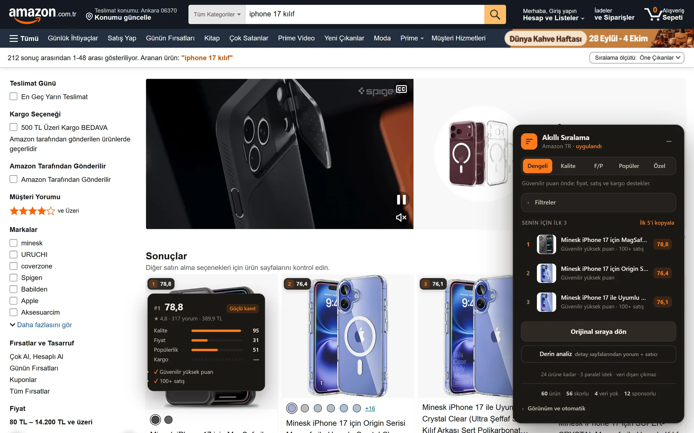

# Akıllı Ürün Sıralama

**Yıldıza değil, kanıta göre sırala.** Hepsiburada, Trendyol ve Amazon Türkiye arama sayfalarındaki ürünleri puan güveni, yorum sayısı, fiyat, satış ve kargoya göre yeniden dizen Chrome/Edge eklentisi. Her ürünün neden o sırada olduğunu gösterir, gördüğün fiyatları hatırlar ve şişirilmiş indirimi işaretler.

**Tanıtım sayfası:** https://berkdemir18.github.io/akilli-urun-siralama/
**İndir:** [Son sürüm (ZIP)](https://github.com/berkdemir18/akilli-urun-siralama/releases/latest/download/akilli-urun-siralama.zip)



## Özellikler

- **Beş sıralama modu:** Dengeli, Kalite, Fiyat/Performans, Popüler ve kaydırıcılarla ayarlanan Özel.
- **"Neden bu sırada?":** Rozetin üzerine gelince kalite/fiyat/popülerlik/kargo çubukları, kanıt gücü ve uyarılar ("sadece 2 yorum, 5 yıldız yanıltıcı olabilir").
- **Filtreler:** Minimum puan ve yorum, fiyat aralığı, başlıkta olsun/olmasın kelimeleri.
- **Fiyat hafızası:** Gezdiğin ürünlerin fiyatı cihazda saklanır; "N günün en düşüğü", "X gün önce Y TL'ydi", "üstü çizili fiyat hiç görülmedi".
- **Derin analiz:** İsteğe bağlı olarak ilk 24 ürünün detay sayfasından yorum metni ve satıcı sinyali okunur.
- **İlk 5'i kopyala**, sürüklenebilir panel, sponsorlu ürün tespiti, `Alt+Shift+S` kısayolu.

## Kurulum

1. [ZIP'i indir](https://github.com/berkdemir18/akilli-urun-siralama/releases/latest/download/akilli-urun-siralama.zip) ve kalıcı bir klasöre çıkar.
2. `chrome://extensions` (Edge: `edge://extensions`) sayfasını aç.
3. **Geliştirici modu**nu aç.
4. **Paketlenmemiş öğe yükle** → çıkardığın klasörü seç.

## Nasıl puanlar?

Az yorumlu puanlar genel ortalamaya çekilir: `(puan × yorum + 4,2 × 30) ÷ (yorum + 30)`. Yorum ve satış adetleri logaritmik değerlendirilir, fiyat yalnızca aynı sayfadaki ürünlerle kıyaslanır, okunamayan sinyal uydurulmaz. Ayrıntı: [extension/README.md](extension/README.md).

## Gizlilik

Hiçbir veri sunucuya veya üçüncü tarafa gönderilmez. Fiyat hafızası `chrome.storage.local` içinde, yalnızca senin tarayıcında durur. Eklenti sadece üç alışveriş sitesinde çalışır.

## Doğrulama

30 Eylül 2026'da canlı arama sayfalarında okunan fiyat, sitenin gösterdiği fiyatla kart kart karşılaştırıldı: **Hepsiburada 36/36, Amazon TR 60/60.** Trendyol bot koruması nedeniyle otomatik testle doğrulanamadı; sorun görürsen [issue aç](https://github.com/berkdemir18/akilli-urun-siralama/issues).

## Geliştirme

```bash
node extension/score.test.js
```

`score.js` saf puanlama/ayrıştırma mantığıdır (Node'da test edilir), `content.js` sayfaya panel ve rozetleri ekler.

---

Hepsiburada, Trendyol ve Amazon ilgili şirketlerin markalarıdır; bu proje onlarla bağlantılı değildir.
